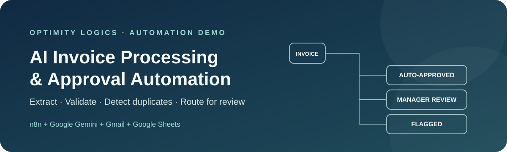

<!-- Project banner -->

  

<h1 align="center">AI Invoice Processing &amp; Approval Automation</h1>

  An n8n workflow that extracts invoice details with Google Gemini, validates the results with code, checks vendors and duplicates, and routes invoices to automatic approval, manager approval, or manual review.

  
  
  
  
  

  <a href="#at-a-glance">Overview</a> ·
  <a href="#how-the-workflow-works">Workflow</a> ·
  <a href="#testing-and-results">Testing</a> ·
  <a href="#setup-and-configuration">Setup</a> ·
  <a href="#limitations-and-production-readiness">Production readiness</a>

---

## At a glance

| Item | Detail |
|---|---|
| **Task** | AI Invoice Processing Agent (Finance) |
| **What it does** | Reads invoices from Gmail, extracts and checks the data, and routes each invoice for approval |
| **Built with** | n8n, Google Gemini, Gmail, Google Sheets, JavaScript |
| **Tested with** | 6 synthetic sample invoices; all six scenarios passed |
| **Approval threshold** | ₹50,000 |
| **Human oversight** | Required for high-value invoices and every flagged invoice |
| **Core idea** | AI reads the document; code and business rules make the decisions |
| **Project type** | Automation demo / proof of concept |

> **Important:** This is an invoice-processing and decision-recording demo. It does not initiate payments or move money.

## Table of contents

- [The business problem](#the-business-problem)
- [The solution](#the-solution)
- [How the workflow works](#how-the-workflow-works)
- [The three outcomes](#the-three-outcomes)
- [Tools and technologies](#tools-and-technologies)
- [Testing and results](#testing-and-results)
- [Human approval and safety controls](#human-approval-and-safety-controls)
- [Setup and configuration](#setup-and-configuration)
- [Suggested Google Sheets structure](#suggested-google-sheets-structure)
- [Limitations and production readiness](#limitations-and-production-readiness)
- [Key learnings and next improvements](#key-learnings-and-next-improvements)
- [Repository structure](#repository-structure)
- [Security](#security)
- [About](#about)

## The business problem

Finance teams often receive vendor invoices as PDF attachments by email. Someone must open each PDF, copy the vendor name, invoice number, dates, and amounts into a spreadsheet, check whether the vendor is approved, look for duplicates, and send higher-value invoices to a manager.

This repetitive process takes time and can introduce costly mistakes. A missed duplicate can lead to paying the same bill twice, while an incorrect total can result in overpayment.

### The manual process

1. Download the invoice PDF from the email.
2. Enter the vendor and payment details into a spreadsheet.
3. Check that the vendor is approved and the invoice is not a duplicate.
4. Send high-value invoices to a manager and wait for a decision.
5. Track the result and notify the relevant people.

## The solution

This project uses **n8n** to orchestrate an AI-assisted invoice-processing workflow. Gmail supplies incoming invoice PDFs, Google Gemini extracts structured information from the document text, and JavaScript Code nodes apply explicit validation and business rules. Google Sheets stores the vendor reference list and invoice records, while Gmail sends notifications and manager approval requests.

The workflow is designed to automate routine handling while keeping people involved where judgement is needed.

### Workflow overview

1. **Receive:** Gmail watches for emails matching the invoice/PDF search criteria.
2. **Extract:** The PDF is converted into text.
3. **Structure:** Google Gemini extracts invoice fields into a defined format.
4. **Validate:** JavaScript checks required fields and the arithmetic relationship between subtotal, tax, and total.
5. **Verify:** Google Sheets supplies the approved-vendor list and existing invoice records.
6. **Detect:** Code flags unknown vendors and duplicate invoices.
7. **Route:** Business rules select auto-approval, manager approval, or manual review.
8. **Record and notify:** The invoice status is saved, and Gmail sends the appropriate notification.
9. **Update:** After a manager responds, the spreadsheet record is updated with the decision.

The intended flow is: Gmail invoice → PDF text extraction → Gemini field extraction → validation → vendor and duplicate checks → routing → record keeping and notification.

## How the workflow works

| Step | Node / stage | What it does |
|---:|---|---|
| 1 | **Gmail Trigger** | Checks for emails matching the invoice/PDF search criteria and starts a run when a matching email is found. |
| 2 | **Extract from File** | Converts the PDF content into text for processing. |
| 3 | **Information Extractor + Google Gemini** | Extracts vendor name, invoice number, invoice date, due date, subtotal, tax, total, and currency into a structured format. Missing information should be returned as empty rather than guessed. |
| 4 | **Validation (JavaScript)** | Checks required fields and verifies that subtotal plus tax matches the invoice total, subject to the workflow's validation logic. |
| 5 | **Get Vendors / Get Invoices** | Loads the approved-vendor reference list and existing invoice records from Google Sheets. |
| 6 | **Check Vendor and Duplicate (JavaScript)** | Flags vendors not on the approved list and duplicate invoices. Duplicate detection uses vendor and invoice number; the workflow also checks for duplicates within the same batch. |
| 7 | **Decide Route** | Applies the validation results and the ₹50,000 approval threshold to assign the next status. |
| 8 | **Append row in sheet** | Records the invoice and its status/reason, including invoices that need manual review. |
| 9 | **Route** | Sends the item to the appropriate outcome branch. |
| 10 | **Gmail notifications / Update After Approval** | Sends the relevant notification or manager approval request. After the manager responds, the sheet record is updated with the decision. |

### Extracted invoice fields

The AI extraction stage is intended to return:

- Vendor name
- Invoice number
- Invoice date
- Due date
- Subtotal
- Tax
- Total
- Currency

Extraction is not treated as approval. The extracted fields are checked by the workflow before a route is selected.

## The three outcomes

| Outcome | Rule | What happens |
|---|---|---|
| **AUTO-APPROVED** | Required data and totals pass validation, the vendor is approved, the invoice is not a duplicate, and the total is **₹50,000 or less**. | The invoice record is saved and a notification email is sent. |
| **PENDING MANAGER APPROVAL** | The invoice passes validation and vendor/duplicate checks, but the total is **above ₹50,000**. | Gmail sends a manager approval request with **Approve** and **Disapprove** options. The workflow waits for a response and then updates the spreadsheet status to **Approved by Manager** or **Rejected by Manager**. |
| **FLAGGED** | A required field is missing, totals do not match, the vendor is unknown, or a duplicate is detected. | The invoice is recorded with the reason and an alert is sent for human review. |

The threshold is currently **₹50,000** and is fixed in the workflow configuration. Confirm the intended currency and business policy before using this design outside a demo.

## Tools and technologies

| Tool | Used for | Why it is used |
|---|---|---|
| **n8n (cloud)** | Workflow orchestration | Connects email, extraction, validation, spreadsheet, and notification steps visually. |
| **Google Gemini** | Invoice data extraction | Converts invoice text into structured fields for downstream checks. |
| **Gmail** | Receiving invoices and sending alerts/approval requests | Matches the email-based invoice intake and notification process. |
| **Google Sheets** | Approved-vendor list and invoice records | Provides a simple, inspectable data store for the demo. |
| **JavaScript Code nodes** | Validation, duplicate checks, and routing | Keeps important business decisions explicit and testable. |

## Testing and results

The workflow was tested using **six synthetic invoices containing no real financial or customer data**. Each test invoice was sent from a separate Gmail account to the monitored inbox. The resulting spreadsheet records and email notifications were checked.

| # | Test scenario | Expected result | Reported result |
|---:|---|---|---|
| 1 | Clean invoice from an approved vendor, total ₹10,030 | Auto-approved | **Passed** — status was AUTO-APPROVED and a notification email arrived. |
| 2 | The same invoice sent again | Flagged as duplicate | **Passed** |
| 3 | Invoice with no invoice number | Flagged for missing required data | **Passed** |
| 4 | Invoice total printed as ₹18,700 when it should be ₹17,700 | Flagged for total mismatch | **Passed** |
| 5 | Vendor not present on the approved list | Flagged as unknown vendor | **Passed** |
| 6 | Valid invoice for ₹295,000 | Sent for manager approval | **Passed** — the invoice became pending, an approval request was received, and the approved decision updated the record to Approved by Manager. The disapproval path was also tested and produced Rejected by Manager. |

These results describe the scenarios tested for this demo; they are not a guarantee of accuracy for every invoice layout, email pattern, currency, or production workload.

## Human approval and safety controls

Human review is a deliberate part of the design:

- A manager must decide on every valid invoice above ₹50,000.
- Every flagged invoice requires a person to review the issue.
- The workflow records decisions and sends notifications; **it does not pay invoices**.
- AI extraction and business approval are separate stages. The model extracts data, while deterministic workflow logic applies the configured checks and routing rules.

Before acting on an invoice, finance staff should verify the original document and the recorded values according to their organization's controls.

## Setup and configuration

This project is a demo built in n8n Cloud. The steps below describe the required configuration; exact node options can vary with the n8n version and the exported workflow.

### Prerequisites

- An n8n instance with permission to create and run workflows.
- A Gmail account or dedicated mailbox for receiving test invoices.
- Google Gemini credentials/API access configured for the Information Extractor node.
- A Google Sheets document with an approved-vendor list and invoice records.
- Test-only invoice PDFs. Do not use confidential or real vendor documents for an initial test.

### Configuration checklist

1. **Prepare the Google Sheet.** Create a vendor reference tab and an invoice-record tab. Add a few approved test vendors and ensure the invoice tab can store extracted fields, status, and review reason.
2. **Connect Gmail.** Authorize the Gmail Trigger and Gmail notification/approval nodes with the intended test account.
3. **Connect Google Gemini.** Configure the model credentials used by the Information Extractor node.
4. **Connect Google Sheets.** Authorize access and select the correct spreadsheet and tabs for the vendor lookup, existing invoice lookup, and invoice append/update steps.
5. **Review the matching rules.** Confirm the Gmail query catches only intended invoice messages and PDF attachments.
6. **Check the business rules.** Verify required fields, subtotal/tax/total validation, vendor matching, duplicate matching, and the ₹50,000 threshold.
7. **Run the six test scenarios.** Verify each resulting status, reason, notification, and manager decision update.
8. **Activate only after review.** Test with a dedicated mailbox and synthetic data before enabling any live intake.

### Importing the workflow

When the n8n workflow export is available in this repository, import the JSON through the n8n workflow editor, then reconnect your own credentials and select your own spreadsheet. **Credential IDs, spreadsheet IDs, email addresses, and other account-specific values should never be copied from someone else's export.** Review each node before activating the workflow.

> **Repository note:** This README documents the workflow design and test results. The n8n workflow export and sample PDFs should be added as separate repository files before a reader can import and run the complete demo directly from this repository.

## Suggested Google Sheets structure

The exact column names can be adjusted to match the workflow's expressions. A practical demo layout is:

### Approved vendors tab

| Column | Purpose |
|---|---|
| Vendor name | Name used to match the extracted invoice vendor |
| Vendor ID (optional) | Stable internal identifier |
| Approved | Whether the vendor is approved for processing |

### Invoice records tab

| Column | Purpose |
|---|---|
| Vendor name | Extracted vendor name |
| Invoice number | Extracted invoice identifier |
| Invoice date | Date shown on the invoice |
| Due date | Payment due date shown on the invoice |
| Subtotal | Extracted subtotal |
| Tax | Extracted tax amount |
| Total | Extracted invoice total |
| Currency | Currency identified from the invoice |
| Status | Auto-approved, pending manager approval, flagged, or manager decision |
| Reason / review notes | Why the invoice was flagged or routed |
| Processed at (recommended) | Timestamp for tracking and troubleshooting |

These are suggested fields for documentation; ensure they align with the actual columns referenced by your n8n nodes.

## Limitations and production readiness

This is a proof of concept, not a production accounts-payable system. Important limitations and next steps include:

- **Text-based PDFs:** The current extraction path converts PDF content to text. Scanned or image-only PDFs need an OCR or vision-capable extraction path and separate testing.
- **Approval concurrency:** Approvals were tested one at a time. A production implementation should handle multiple pending approvals safely, ideally with a separate approval workflow and a stable invoice identifier.
- **Email sending limits:** Gmail rate limits were encountered during testing. Production notifications may need a dedicated email provider and retry/backoff handling.
- **Google Sheets as storage:** Sheets is convenient for a demo but is not a robust transactional database. A production system should consider PostgreSQL or another database, unique constraints, and safe concurrent writes.
- **Configurable approval threshold:** The ₹50,000 threshold is fixed in the current workflow and should be configurable, with currency-aware policy rules.
- **Error handling and monitoring:** Add failure alerts, retries, execution monitoring, and a recovery path for partially completed runs.
- **Access control and auditability:** Restrict access to invoices and approval links, log decisions, and define retention rules for financial documents.
- **Duplicate policy:** Confirm the business's definition of a duplicate. Vendor name plus invoice number is useful for a demo but may need normalization and additional checks in production.
- **Data validation:** Define rounding tolerance and currency-specific decimal rules for subtotal/tax/total checks.
- **Security and compliance:** Review the handling of invoice text sent to the AI provider, data residency, access permissions, and organizational requirements before processing real documents.

## Key learnings and next improvements

### Key learnings

- **AI reads; code decides.** Keeping validation and routing in code makes decisions more predictable and easier to explain.
- **Do not let the model guess.** Asking the extractor to leave missing fields empty helps the workflow detect incomplete invoices rather than silently filling gaps.
- **Real-world automation needs resilience.** Rate limits, retries, concurrency, and partial failures need explicit handling.
- **Human review is essential.** Automation can reduce repetitive work while keeping approval and exception handling under human control.

### Planned improvements

1. Add OCR or vision-based extraction for scanned invoices.
2. Move manager approvals into a separate workflow with stable invoice IDs and concurrency-safe updates.
3. Add an error-alert workflow and retry/backoff policies.
4. Move invoice records from Google Sheets to a database such as PostgreSQL for production use.
5. Make approval limits and validation policies configurable.
6. Add stronger audit logging and operational monitoring.
7. Consider adding a payment step only after approval, with separate security controls and explicit authorization.

## Repository structure

The intended project structure is:

    ai-invoice-processing-automation/
    ├── README.md
    ├── workflow.json                  # n8n workflow export (to be added)
    ├── samples/
    │   ├── 01-valid-invoice.pdf       # synthetic test invoice (to be added)
    │   ├── 02-duplicate-invoice.pdf   # synthetic test invoice (to be added)
    │   ├── 03-missing-invoice-no.pdf  # synthetic test invoice (to be added)
    │   └── ...
    └── docs/
        └── assets/
            └── invoice-automation-banner.svg

Only files that have actually been committed are available in the repository. The workflow export and sample PDFs shown above are planned additions, not included by this README commit.

## Security

- Never commit API keys, OAuth tokens, credential exports, environment files, or private client secrets.
- Remove personal email addresses, private spreadsheet IDs, credential IDs, and other account-specific identifiers from workflow JSON before publishing.
- Use synthetic invoice PDFs in public demos. Do not upload real invoices, bank details, tax IDs, or vendor contact information.
- Configure credentials through n8n's credential manager after importing the workflow.
- Keep access to the Gmail inbox, spreadsheet, and approval actions restricted to authorized users.
- Review workflow execution logs because invoice text and extracted fields may be sensitive.

## About

Built by **[Optimity Logics](https://optimitylogics.com)**.

This repository demonstrates practical AI automation with n8n, Google Gemini, Gmail, and Google Sheets, with an emphasis on explicit business rules, traceable outcomes, and human review.

---

  Built as an automation demo. Validate the workflow and adapt it to your organization's finance policies before production use.

